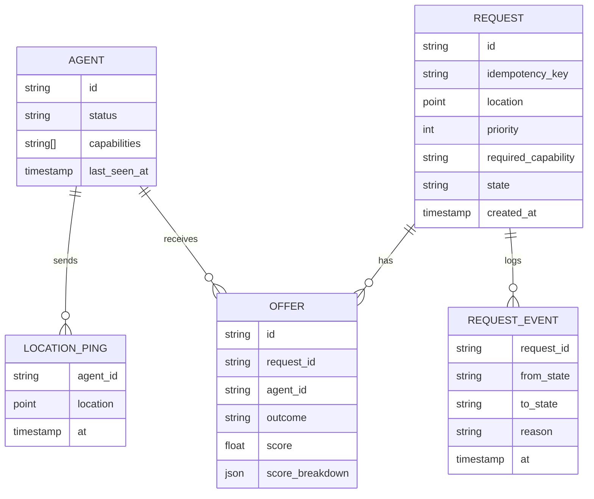

# Data Model

> [!todo] ✍️ Finish this after ADR-002 is decided. Below is a first guess.

## What lives where
| Data | Redis (live) | Postgres (history) |
|---|---|---|
| Latest agent position | ✅ | snapshot only? ✍️ |
| Heartbeat | ✅ (TTL) | ❌ |
| Requests & state | ✍️ | ✅ |
| Event log | ❌ | ✅ |
| Every ping | ❌ | ✍️ all? sampled? (think about storage) |
