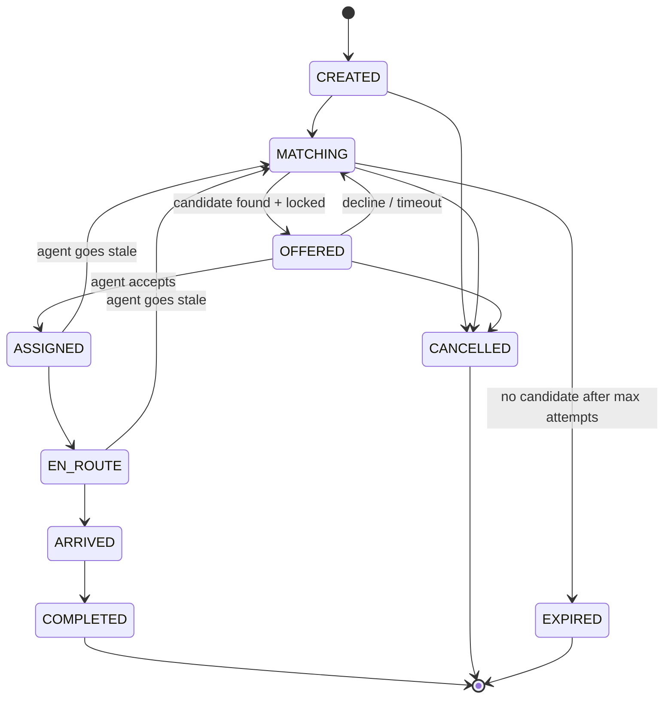

# Request Lifecycle (state machine)

## Rules
- Every transition is written to an **event log** (who, when, from → to, reason).
- Illegal transitions (e.g. COMPLETED → MATCHING) must be **rejected in code** and covered by tests.

> [!todo] ✍️ Decide and write down
> - Offer timeout: ___ s
> - Max matching attempts before EXPIRED: ___
> - Can a P1 request steal an agent from a P3 offer? Why or why not?

## Agent status (separate state machine)
`OFFLINE → AVAILABLE → OFFERED → BUSY → AVAILABLE` (plus `STALE`, which is derived from the heartbeat)
> [!todo] ✍️ Draw this one yourself.
