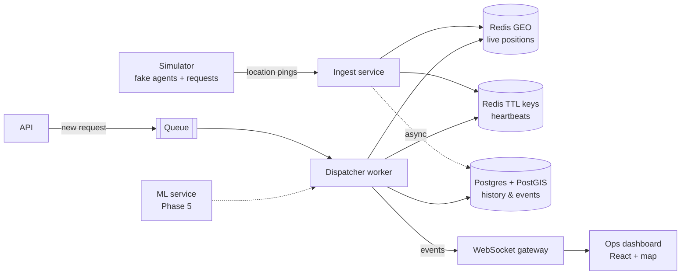

# System Overview

> [!warning] Draft, a starting point only
> This diagram is a **hypothesis**. Redraw it yourself in Excalidraw or Canvas once you understand each box. You must be able to whiteboard it from memory in an interview.

## Components
| Component | Responsibility | Why separate? (✍️ answer) |
|---|---|---|
| Simulator | Moves N agents, emits pings, creates requests and spikes | |
| Ingest | Accepts pings, updates live state | |
| Dispatcher | Matching, scoring, offers, timeouts, reassignment | |
| API | REST for requests and queries | |
| WebSocket gateway | Pushes live updates to dashboards | |
| Dashboard | Map, queue, explanations | |

## Hot path vs cold path
- **Hot path** (latency matters, < 1 s): ping → Redis; request → match → offer.
- **Cold path** (correctness matters, can lag): event history → Postgres.

> [!question] ✍️ Questions to answer before Phase 2
> - What happens to an in-flight request if the dispatcher process crashes?
> - What happens if Redis restarts?
> - Who owns the "truth" for an agent's status: Redis or Postgres?
